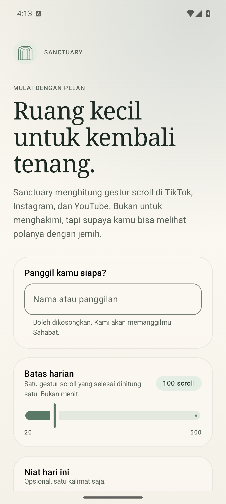
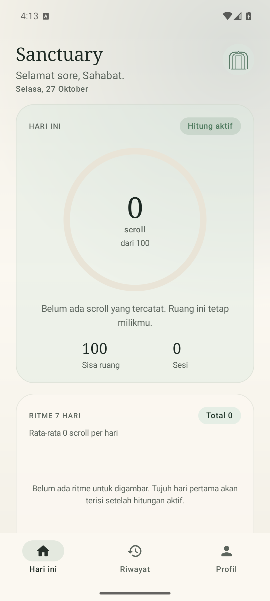
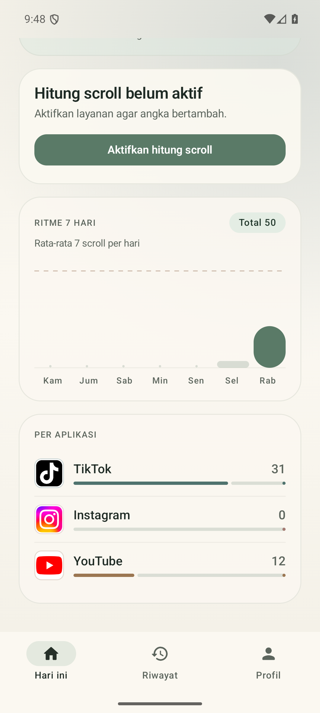
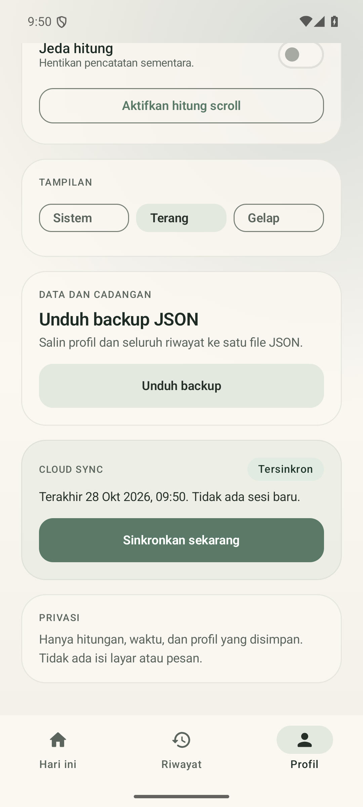

# Sanctuary

A native Android app for seeing how many scroll gestures you make in TikTok,
Instagram, and YouTube. Offline-first, without email or Google, with an optional
anonymous account for sync and standalone JSON backup.

> Status: **MVP 0.1.1 + cloud sync**. Debug/release builds and all unit tests
> pass. Real-device verification of TikTok/Instagram/YouTube counting accuracy
> is still required.

| Onboarding | Dashboard |
|---|---|
|  |  |

## Why Android first

Android gives apps access to `TYPE_VIEW_SCROLLED` events through
AccessibilityService. iOS does not provide an official way to count scrolls
inside third-party apps; Screen Time only gives coarse duration/usage. That is
why Sanctuary is built as native Android, not a cross-platform promise that only
half works.

## Features

| Feature | Status |
|---|---|
| Count TikTok, Instagram, and YouTube scrolls | Available through AccessibilityService |
| Count YouTube Shorts transitions | Available through title transitions in the YouTube node tree |
| Official platform logos | Available, using each brand's assets |
| Daily dashboard + target | Available |
| 7/30-day history + session detail | Available |
| Profile, daily intention, scroll limit | Available |
| Pause counting | Available |
| Offline-first | Available; network only for optional sync |
| JSON backup via file picker | Available |
| JSON import | Not yet |
| Supabase anonymous sync | Available, opt-in; encrypted token |
| Email/Google sign-in | Not used |
| iOS | Not supported |



## Important limitations

Android reports signals per **package**, not per tab. Instagram feed and Reels
still cannot be separated. YouTube Shorts uses a pager that does not emit
`TYPE_VIEW_SCROLLED`; Sanctuary detects Shorts transitions from the title and
channel name shown on the player surface. The count represents **Shorts
transitions**, not videos watched to completion. The regular YouTube feed is
still counted through package scroll events.

One completed gesture counts as one. Framework fling events are merged with a
350 ms quiet period per app: events during a burst do not add to the number, but
a new gesture after the gap is counted. A new session starts after 30 minutes
without scrolling. The number can be lower than the user's perception when a
target app does not emit a readable event.

## Architecture

```
app
├── feature:onboarding
├── feature:dashboard
├── feature:history
├── feature:profile
├── core:designsystem
├── core:tracking        AccessibilityService + gate
├── core:sync            anonymous auth, encrypted token, push sync
├── core:data            repository, DataStore, JSON backup
├── core:database        Room
└── core:model           model, statistics, backup contract
```

- UI: Jetpack Compose + Material 3.
- State: ViewModel + StateFlow + Flow from Room/DataStore.
- DI: manual composition root (`AppContainer` / `SanctuaryData`), without a framework.
- Offline: Room is the source of truth. Sync only runs when enabled; network
  failure does not delete data.
- Backup: `kotlinx.serialization` to `BackupDocument` version 1.
- Cloud: one anonymous user per device, access/refresh token encrypted with
  Android Keystore, idempotent push through PostgREST.

Details: [`docs/ARCHITECTURE.md`](docs/ARCHITECTURE.md).

## Build

Prerequisites: JDK 21, Android SDK 36, Gradle wrapper 8.13.

```powershell
$env:JAVA_HOME = "C:\Program Files\Android\openjdk\jdk-21.0.8"
$env:ANDROID_HOME = "$env:LOCALAPPDATA\Android\Sdk"
.\gradlew.bat :app:assembleDebug
.\gradlew.bat :app:assembleRelease
.\gradlew.bat test
```

`test` covers JVM unit tests (`core:model`) and Android unit tests
(`core:data`, `core:tracking`, `core:sync`). Debug and release variants run the
same tests.

A signed release is written to `app/build/outputs/apk/release/app-release.apk`
when `keystore.properties` and `keystore/sanctuary-release.jks` are present.
Copy [keystore.properties.example](keystore.properties.example), fill the
passwords, and back up both files. They are ignored by Git; losing them blocks
future in-place updates.

Copy [local.properties.example](local.properties.example) to `local.properties`
and adjust `sdk.dir`. For cloud sync, fill in the same file (not committed):

```properties
SUPABASE_URL=https://xxxx.supabase.co
SUPABASE_ANON_KEY=sb_publishable_...
```

Use a publishable/anon key. Never use `service_role` in the APK. Enable
**Anonymous Sign-Ins** in Supabase Auth and run the migration.

Debug APK: `app/build/outputs/apk/debug/app-debug.apk`.
Signed release APK: `app/build/outputs/apk/release/app-release.apk`.

Install the release:

```powershell
& "$env:ANDROID_HOME\platform-tools\adb.exe" install -r app\build\outputs\apk\release\app-release.apk
```

After onboarding, enable **Pelacakan Sanctuary** in
`Settings > Accessibility`. The service is configured for only four packages:
TikTok (`com.zhiliaoapp.musically`, `com.ss.android.ugc.trill`), Instagram, and
YouTube. `canRetrieveWindowContent=true` is required to read YouTube Shorts
titles; screen content is not stored, logged, or sent.

## JSON backup

The file is created through the Storage Access Framework, so no storage
permission is needed. This backup does not go through Supabase; you choose the
file location yourself.

```json
{
  "format": "sanctuary.backup",
  "schemaVersion": 1,
  "exportedAt": "2026-10-27T08:00:00Z",
  "appVersion": "0.1.1",
  "profile": {
    "local_id": "local-profile",
    "display_name": "Sahabat",
    "daily_goal": 100,
    "timezone_id": "Asia/Jakarta"
  },
  "sessions": [
    {
      "id": "…",
      "platform": "tiktok",
      "local_day": "2026-10-27",
      "started_at": "…",
      "ended_at": "…",
      "scroll_count": 14,
      "source": "accessibility"
    }
  ]
}
```

The backup does not contain screen content, messages, accounts, or tokens.

## Supabase

One anonymous account per device, without email or Google. Enable it once from
the **Cloud sync** card in Profile; the session is stored encrypted and reused
automatically. Pending profiles and sessions are pushed through PostgREST.
Network failure only delays sync.



Important limit: an anonymous user cannot be recovered after app data is
deleted or on another device. JSON backup is the standalone copy. Schema and RLS
are in [`supabase/migrations/0001_init.sql`](supabase/migrations/0001_init.sql);
activation steps are in [`supabase/README.md`](supabase/README.md).

## Verification

| Check | Result |
|---|---|
| `:app:assembleDebug` | Succeeded, 19.4 MB debug APK |
| `:app:assembleRelease` (R8) | Succeeded, 1.6 MB signed APK |
| `:app:lintDebug` | 0 errors, 20 warnings (dependency versions and monochrome icon) |
| Unit test | 33 unique, 58 runs, 0 failures |
| Emulator API 36 | Onboarding, dashboard, history, profile, pause, JSON backup |
| Tracking pipeline | Real `TYPE_VIEW_SCROLLED` event recorded, session and UI updated |
| Shorts detector | Signature unit tests pass; not yet verified on real YouTube |
| JSON backup | Profile + sessions saved and readable |
| Supabase auth | Real anonymous sign-in succeeded |
| Supabase sync | Profile and 1 session sent successfully, status "Tersinkron" |
| RLS | Two anonymous users isolated: user B sees `[]` |
| Real TikTok/IG/YouTube | Not yet tested with real accounts/feeds |

Evidence and limitations are in [`docs/ARCHITECTURE.md`](docs/ARCHITECTURE.md).
Counting accuracy must be tested on a device with all three target apps before
daily use.

## Privacy and Play Store

Using AccessibilityService to monitor other apps requires prominent disclosure
and a Play policy declaration. For personal use, sideloading is safe. Do not
change the service configuration to read content without updating the disclosure
and privacy policy.

Cloud sync sends the profile and scroll counts to your Supabase project. There
is no screen content, messages, or third-party tokens. For Shorts, titles and
channel names are read in device memory only and are not written to the
database.

TikTok, Instagram, and YouTube logos are trademarks of their respective owners.
Sources and attribution notes are in [docs/ASSETS.md](docs/ASSETS.md). Never put
a `service_role` key in the app; RLS is the primary security boundary.
